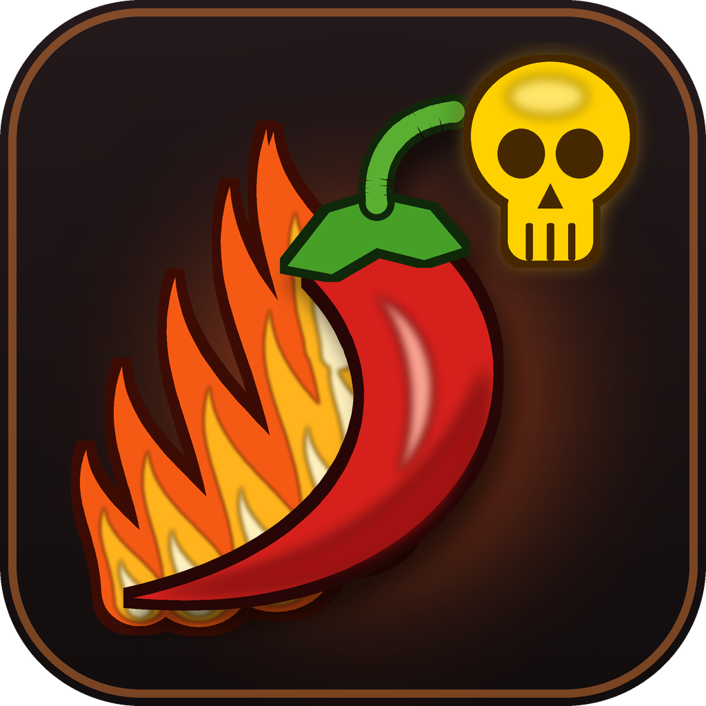

# 🌶️ Spicy Kill Streaks

**Announcer voices, combat text and sparkles for your killing blows in WoW Forever.** Land a killing blow and hear *Killing Spree!*, *Rampage!*, *Godlike!*; chain kills for *Double Kill!* up to *Holy Shit!*. Die and get *Humiliation*.

A rewrite of **dG KillShot** for WoW Forever, which does not give addons the combat log that the original relied on.

## Features

- **Kill streaks**: a rank for every kill in a row: *Headshot* (1), *Ownage* (2), *Killing Spree* (3), *Rampage*, *Dominating*, *Unstoppable*, *Wicked Sick*, then *Godlike* from 8 on, each with its own sound, colour and callout. On every kill, or Unreal Tournament style (every few kills). There are a couple of secrets further up.
- **Multikills**: kills within 30 seconds of each other chain into *Double Kill*, *Triple Kill*, *Multi Kill*, *Mega Kill* and on, up to *Holy Shit*.
- **Special callouts**, only when the addon is sure (otherwise you get the normal callout):
  - *First Blood* on your first kill of the day
  - *Retribution* when you kill someone who killed you in the last hour (and now and then, something else...)
  - *Comeback*: your first kill after dying 3+ times in a row gets a surprise
  - *Pancake* when you (or a friend) die from falling or drowning
  - **Ganks**: kill a player 10+ levels below you and get shamed instead of a callout (it doesn't count towards your streak); die to one 10+ levels above you and hear "You got ganked"
- **Voice packs**: Male, Female, Sexy, Baby and **Flamboyant** (the Heroes of Newerth announcer, with rainbow callouts). Pick a separate voice for *Humiliation*, or add your own sound files.
- **Only your killing blows count**, not kills your group finishes.
- **Effects** (all optional): combat text that punches in and floats up, in a dozen fonts (or any SharedMedia font), sparkle bursts (stars, chillies or confetti), and a screen-edge flash for big moments. Drag them anywhere.
- **Settings window** with a live preview of your font, size and voice pack, a **Sound board** that plays every sound and says when it plays, and a short **setup** on first login.
- **Minimap button** (the chilli): settings, a quick menu, and Shift-click to snooze.
- **Mute** in battlegrounds, dungeons or raids, or snooze for 30 minutes.
- **Guild board**: the month's top kill streaks and most deaths in your guild, shown at login and in the settings, with a button to post it to guild or party chat.
- **Party and guild sync** (on by default, part of the fun): share your kills and deaths with friends who run the addon. For party members and guild members separately, choose whether their kills show in chat, as combat text, with sound, and whether their deaths show too. If a guildmate or party member has a newer version, it tells you in chat. Battlegrounds and arenas are just for you: nothing is shared from them, and they don't count on the guild board.
- **Kudos**: when a friend running the addon gets a kill, or dies, send them an emoji: 😂 😃 👍 👎 🙏 ☠️ 💀 ❤️ 🎉. It pops up on their screen only, or, if you choose, in party or guild chat too.
- **KOS list**: players who keep killing you, with nemeses ("IS NOW YOUR NEMESIS!"), payback callouts (**GRUDGE SETTLED!**, **NEMESIS SLAIN!**) and sighting alerts when one is nearby. `/sks kos <name>` adds anyone.
- **Share with friends** (opt-in): your friends list and Battle.net friends on your realm and faction, with a per-friend list (share with them, show their kills) and a mute list.
- **Request help** (world PvP): when a player kills you, one click asks your party and guild for help, with who killed you and where. Friends get a card with **On my way** and a waypoint, and killing your killer earns them an **AVENGED!**
- **Battleground summary**: at the end of a match, your killing blows and best kill streak, with buttons to share it in battleground or guild chat (or not).
- **Duels**: wins count, losses and fleeing get a *Humiliation*.
- **Stats**: longest streaks, top prey, top predators and a recent log.
- **Debug log** window you can copy from, for bug reports.

## Install

Install from CurseForge, or download `SpicyKillStreaks-vX.Y.Z.zip` from [Releases](https://github.com/zednx/spicy-kill-streaks/releases). Extract it into `World of Warcraft/_forever_/Interface/AddOns/`, then restart the game.

## Commands

| Command | What it does |
|---|---|
| `/sks` or `/killstreaks` | All options |
| `/sks setup` | The first-run setup again |
| `/sks preview` | Show off the effects (`kill`, `rank`, `multi`, `big`, `death`, `other`) |
| `/sks test kill` | Simulate a kill (also `death`, `prepare`) |
| `/sks unlock` / `/sks lock` | Move the text and sparkles |
| `/sks who` | Who in your group and guild runs the addon |
| `/sks emote` | Send your last kill's custom emote message (WoW Forever only lets typed messages go out from a key press; put it in a macro). Built-in emotes like /cheer play by themselves after combat. |
| `/sks synctest` | Send a test kill to your party/guild |
| `/sks snooze` | Mute the sounds for 30 minutes (`/sks snooze 60` for an hour, `/sks snooze off` to undo) |
| `/sks score` | Check that your battleground scoreboard row is found |
| `/sks recap` | Print what your last Death Recap tells addons (for troubleshooting) |
| `/sks classic` | The old options window |
| `/sks kudos` | Preview the Kudos popup and drag it into place (again to lock it); `/sks kudos got` previews kudos you get |
| `/sks aid` | Preview a help request (yours and a friend's) |
| `/sks kos <name>` | Add a player to your KOS list (`/sks kos` opens the page) |
| `/sks friends` | Which friends the addon can see, and why any is left out |
| `/sks mute <name>` | Hide a player's shared kills and deaths (`/sks unmute <name>` to undo) |
| `/sks summary` | A sample of the end-of-match battleground summary |
| `/sks minimap` | Show or hide the minimap button |
| `/sks debug` | Open the debug log: what the kill detection sees, ready to copy |

## How kills are detected

WoW Forever keeps the combat log from addons, so:

| Where | How |
|---|---|
| Battlegrounds and arenas | Your killing blows on the scoreboard |
| Everywhere else | The game's own killing-blow event (`PARTY_KILL`) |
| Your deaths | The Death Recap names your killer |
| Duels | The duel result in chat |

Creature kills only count if you switch on **Count NPC kills too** (handy for trying it out).

## Privacy

Sharing with your party and guild is on by default, and the first-run setup says so with a box to untick. With sharing on, the addon sends your kills and deaths (victim, killer, streak, levels) as hidden addon messages to your party and/or guild; players without the addon see nothing. Sharing with friends (friends list and Battle.net friends on your realm and faction) is off unless you switch it on. Switch them all off on the Friends page and nothing leaves your game. Mute anyone with `/sks mute <name>`. See [SECURITY.md](SECURITY.md).

## Credits and license

- Made by **Spicy Bubbletea** (Horde, WoW Forever PvP). Feedback in game or on GitHub Issues.
- Inspired by **dG KillShot** by Lance Inman. Its voice packs ship with this addon.
- Uses the **Ace3** libraries.
- Kudos emoji are from **Twemoji** (Twitter, Inc and contributors), CC-BY 4.0: [Media/Emoji](SpicyKillStreaks/Media/Emoji).
- The code is licensed under the **GNU GPL v2** (see [LICENSE](LICENSE)), as dG KillShot is.

### Sounds and fonts

- **Announcer voices are not covered by the GPL.** They belong to their owners (the Unreal Tournament announcers are © Epic Games) and are included as they were in dG KillShot. Where each sound comes from: [sounds/CREDITS.txt](SpicyKillStreaks/sounds/CREDITS.txt). Rights holders can ask for removal through GitHub Issues.
- **Fonts** are from Google Fonts: Anton, Bangers, Bebas Neue, Black Ops One, Russo One and Teko under the SIL Open Font License 1.1; Luckiest Guy and Permanent Marker under the Apache License 2.0. Grandstander, Orbitron and Press Start 2P are also OFL 1.1. Expressway is not shipped: it's offered when Daylight UI (which includes it) is installed. Licences: [Media/Fonts](SpicyKillStreaks/Media/Fonts).
